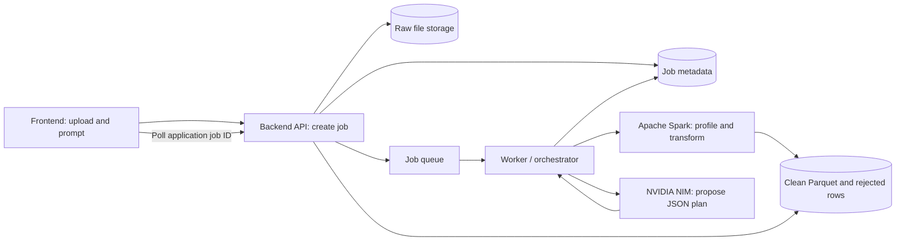

# Prompt-driven CSV cleaning — submission architecture

## One-sentence summary

A user uploads one or more CSV files and describes the cleanup they need. NVIDIA NIM converts the request into a constrained cleaning plan; a backend validates that plan; Apache Spark applies it to the full data and produces typed clean output plus rejected rows with reasons.

## Architecture



## Processing flow

1. Frontend submits CSV files and a natural-language cleaning request.
2. Backend creates an application `job_id`, stores the originals, and queues the job.
3. Spark reads the CSV using an explicit schema and profiles columns, nulls, and representative values.
4. The worker sends the prompt and bounded profile to NIM. NIM returns JSON describing supported operations; it does not return executable code.
5. Backend validates the JSON plan against an allowlist and checks column names and types.
6. Spark applies approved transformations to the complete dataset.
7. Spark writes valid rows to Parquet and invalid rows to a review output with validation reasons. The job report records input, clean, rejected, and duplicate counts.
8. Frontend polls the backend by application `job_id`, then previews or downloads the outputs.

If NIM returns its own asynchronous job ID, the backend worker polls NIM. The frontend polls only the application backend, which keeps the UI independent of NIM's API details.

## Important controls

- Keep the raw uploads unchanged and write each run to a separate output path.
- Use explicit schemas and deterministic Spark transformations.
- Treat NIM output as an untrusted proposal: validate it, allow only known operations, and never execute returned Python or SQL.
- Quarantine invalid rows with reasons instead of dropping them silently.
- Require explicit policies for ambiguous choices such as which conflicting duplicate to retain or how to fill missing values.
- Send only the data needed for profiling to NIM; Spark handles the full files.
- Record job status, plan, counts, and errors so each run can be reviewed.

## Current prototype status

The HTML and `nim_backend.py` form a local prototype. The backend can make a real server-side NVIDIA API Catalog chat-completion request when `NVIDIA_API_KEY` and `NIM_MODEL` are configured. It sends the prompt and column names, validates the returned JSON against an operation allowlist, and does not expose the key to the browser. The shown cleaned/rejected rows and counts are still generated by local demo rules; they are not processed by Spark and are not guaranteed to follow the returned NIM plan. The displayed job ID/status are demo UI behavior, not a persistent job service.

The default API Catalog endpoint is `https://integrate.api.nvidia.com/v1/chat/completions`. Configure a model ID from the chosen model's API page. Do not put the key in the HTML or commit it to a file.

### Start the local prototype

In PowerShell, set the key and chosen model ID in the same terminal session, then start the server from the `outputs` folder:

```powershell
$env:NVIDIA_API_KEY = Read-Host "Enter NVIDIA API key locally"
$env:NIM_MODEL = "<model-id-from-your-NVIDIA-model-page>"
python .\nim_backend.py
```

Open `http://127.0.0.1:8765`. The browser sends only the prompt, column names, and row count to the local backend. The backend sends those to NIM. It does not upload CSV row values.

## Suggested short demo

1. Start the local backend with a valid key and model ID, then open the local page.
2. Click **Load sample** and **Create cleaning preview**.
3. Explain that the NIM request is real and the row cleanup is simulated.
4. Open **Applied plan** to show the actual NIM JSON response.
5. Show the simulated counts: 5 input rows, 2 clean rows, and 3 rejected rows; inspect reject reasons and downloads.
6. Explain that the production processing path replaces the browser demo rules with a backend job worker and Spark transformations that execute a validated NIM plan.

## Immediate implementation sequence

1. Run a fixed-rule PySpark batch job against representative CSVs.
2. Add backend job creation, status, preview, and download APIs.
3. Add a worker/queue and persistent raw/output storage.
4. Connect NIM through a server-side adapter that requests structured JSON.
5. Validate NIM plans and map allowlisted operations to Spark functions.
6. Connect the frontend to the backend and replace simulated status with real job polling.
